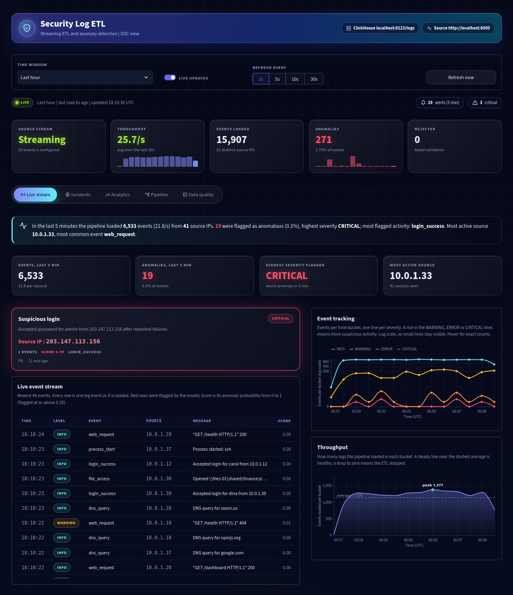
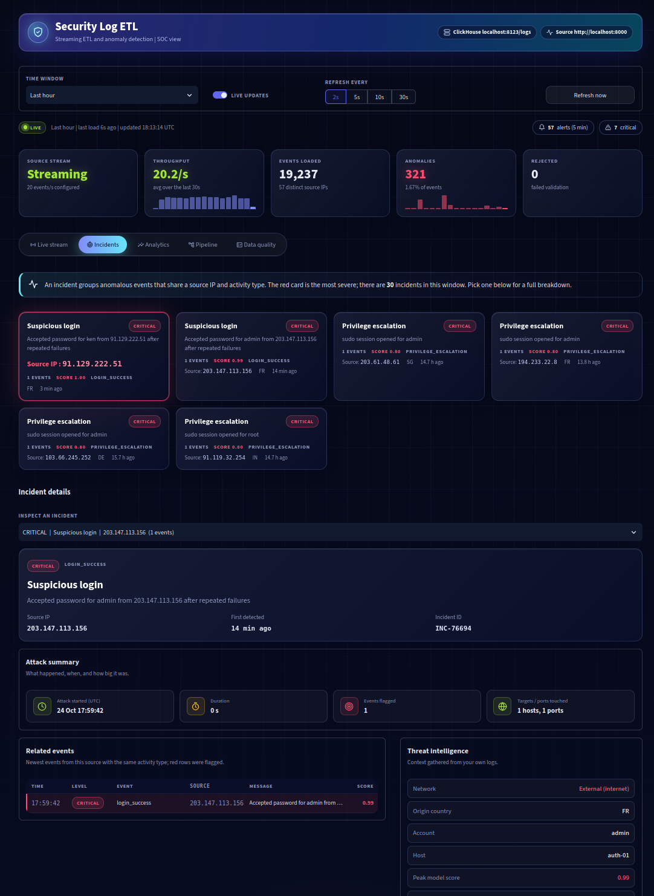
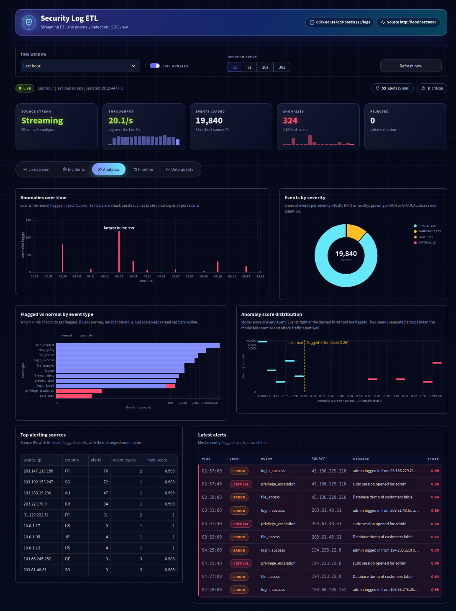
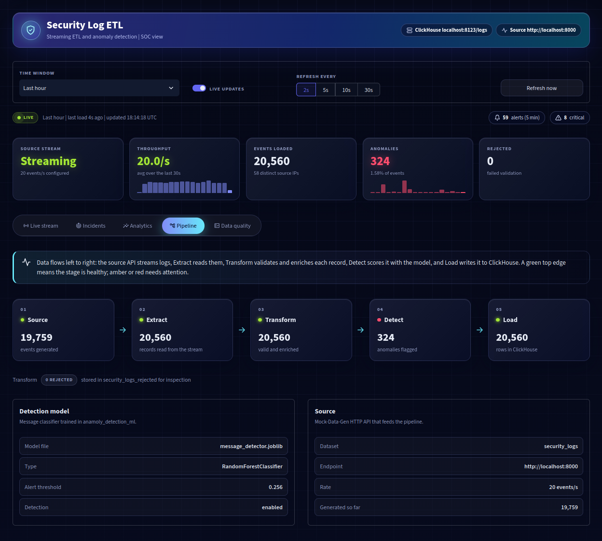
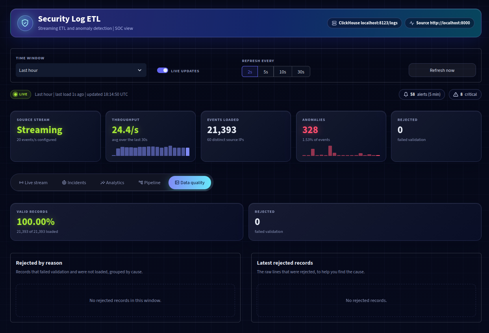

# Log Anomaly Detection

Dashboard to perform log streams analysis and anomaly detection.

Example:

> Log Analytics

```json
{
    "name": "security_logs",
    "count": 1,
    "cursor": 1,
    "data": [
      {
        "event_id": "a4a98434-427f-4aba-a4a1-f3700927eb2d",
        "timestamp": "2026-10-24 18:06:45.306",
        "host": "auth-01",
        "source_ip": "10.0.1.19",
        "dest_ip": "10.0.30.5",
        "dest_port": 22,
        "username": "judy",
        "event_type": "login_failed",
        "severity": "WARNING",
        "country": "US",
        "bytes_out": 0,
        "message": "Failed password for judy from 10.0.1.19 port 52318 ssh2"
      }
    ]
}
```

## ETL pipeline

Mock-Data-Gen `security_logs` stream (NDJSON) -> extract -> transform -> detect -> load -> ClickHouse, with a Streamlit dashboard on top.

```
migrations/    goose SQL migrations for ClickHouse
src/stream_log_anamoly_detection/
  config/      environment settings
  extract/     HTTP stream client (auto-creates/starts the dataset, reconnects with backoff)
  transform/   validate, type-cast, enrich (severity_level, is_internal_source, is_off_hours)
  detection/   message RandomForest from ../anamoly_detection_ml (anomaly_score, is_anomaly)
  load/        batched ClickHouse inserts; invalid rows go to security_logs_rejected
  storage/     ClickHouse client, schema check, goose runner
  dashboard/   Streamlit app (pipeline flow, throughput, anomalies, data quality, migrations)
  pipeline.py  orchestration
  cli.py       `migrate`, `run` and `dashboard` commands
```

Tables (database `logs`): `security_logs` (ReplacingMergeTree, partitioned by month) and `security_logs_rejected`.
The schema is owned by [goose](https://github.com/pressly/goose); the app never creates tables itself.

### Prerequisite

1. Install [go](https://go.dev/doc/install)

2. Install [goose](https://pressly.github.io/goose/)

```bash
go install github.com/pressly/goose/v3/cmd/goose@latest
```

> If there is issue: add Go's binary directory to your Zsh/Bash PATH

```bash
echo 'export PATH="$PATH:$(go env GOPATH)/bin"' >> ~/.zshrc
source ~/.zshrc
```

### Run app

1. Create required dependencies

```bash
cp .env.example .env
docker compose up -d                  # ClickHouse DB

uv venv
source .venv/bin/activate

uv sync
```

2. Run the log streaming mock data : [mock-data-gen](https://github.com/Saphall/Mock-Data-Gen) - `Security Logs` logs template locally
> this will expose live stream logs on: `http://localhost:8000`


3. Run the required migrations

```bash
uv run app migrate  
# OR
python -m stream_log_anamoly_detection migrate           # goose up; also: migrate status | migrate down
```

4. RUn the stream and detect the anomaly using the `message_detector.joblib` model

```bash
# start Mock-Data-Gen on :8000 (see ../Mock-Data-Gen), then:
uv run app run 
# OR
python -m stream_log_anamoly_detection run               # Ctrl+C to stop; --max-events N, --no-detection
```

5. Run the dashboard
```bash
uv run app dashboard
# OR
python -m stream_log_anamoly_detection dashboard         # Streamlit on http://localhost:8501 (or: uv run app)
```

6. Tests

```bash
pytest
# OR 
uv run pytest
```

New schema changes: `goose -dir migrations create <name> sql`. ClickHouse has no transactional DDL, so every
migration starts with `-- +goose NO TRANSACTION` and must be idempotent (`IF NOT EXISTS`).

Detection uses `message_detector.joblib` (default `../anamoly_detection_ml/artifacts/`, override with
`ANOMALY_MODEL_PATH`). It is a pickle, so only load artifacts you trust, with scikit-learn 1.9.x. The alert threshold
comes from the model unless `ANOMALY_THRESHOLD` is set.

## Dashboard

### Live stream



### Incidents



### Analytics



### Pipeline



### Data quality


